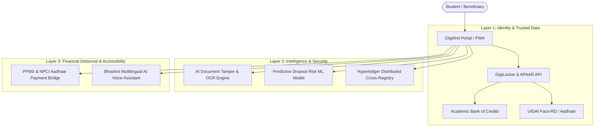

# Chapter: Future Scope & Advanced Enhancements
## National Scholarship Renewal & Eligibility Re-Verification Portal (Eligifind)

---

### Executive Summary

While the **Eligifind MVP (Minimum Viable Product)** delivers an automated deterministic rule engine across 82 schemes, document lifecycle tracking, and end-to-end renewal re-verification, enterprise production deployment requires deep integration with national digital public infrastructure, artificial intelligence, and distributed security architectures.

This chapter outlines seven pivotal futuristic enhancements designed to scale Eligifind into an enterprise-grade, fraud-resilient, and universally accessible National Digital Scholarship Ecosystem.



---

## 1. Integration with DigiLocker and APAAR / Academic Bank of Credits (ABC)

### 1.1 Objective & Overview
Replaces manual document uploads (PDF/JPEG) with frictionless, single-click verification leveraging National Digital Public Infrastructure (DPI)—specifically **DigiLocker**, **UIDAI Aadhaar**, and the Ministry of Education's **APAAR ID (Automated Permanent Academic Account Registry)**.

### 1.2 Technical Architecture & Mechanism
- **OAuth 2.0 PKCE Handshake**: When applying or renewing, students authorize Eligifind to request digitally signed credentials via National DigiLocker Gateway APIs.
- **Direct XML/JSON Extraction**: Rather than parsing raster images, the system extracts cryptographically signed payload data (X.509 certificates) from:
  - State Revenue Departments (Income & Domicile Certificates)
  - Social Welfare Boards (Caste / Community Certificates)
  - State & Central Examination Boards (Secondary & Higher Secondary Marksheets)
  - ABC / NAD (National Academic Depository) for university credit scores and CGPA.

### 1.3 Measurable Impact
- **Zero Counterfeit Certificates**: Cryptographic signature validation eliminates photoshopped or forged certificates.
- **Verification Velocity**: Processing turnaround drops from **3–7 business days to sub-second automated verification**.
- **User Experience**: Drastically minimizes student upload friction, eliminated file size restrictions and format conversion errors.

---

## 2. AI-Powered Document Authenticity & OCR Verification

### 2.1 Objective & Overview
Provides an automated safety net for legacy certificates, offline institutional records, and non-digitized diplomas that still require manual photo/PDF upload.

### 2.2 Technical Architecture & Mechanism
- **Computer Vision Tampering Detection**:
  - Employs **Convolutional Neural Networks (CNNs)** and Error Level Analysis (ELA) to detect digital artifact splicing, clone-stamp tampering, font mismatches, and synthetic overlays.
  - Optical stamp and signature validation against known government issuing authority templates.
- **Automated Text Extraction & Cross-Checking**:
  - High-precision **OCR (Tesseract / Cloud Vision API)** extracts candidate name, roll number, father's name, total marks, percentage, and annual income.
  - Real-time string distance algorithms (Levenshtein & Jaro-Winkler) calculate congruence scores between user-typed form inputs and OCR-extracted document values. If disparity exceeds 5%, an audit flag is triggered.

### 2.3 Measurable Impact
- **Proactive Caseworker Offloading**: Filters out 95% of invalid or forged submissions prior to human nodal scrutiny.
- **Error Elimination**: Prevents inadvertent student typos in income amounts or roll numbers from causing accidental scheme disqualification.

---

## 3. Aadhaar Payment Bridge (APBS) & PFMS Integration for Direct Benefit Transfer (DBT)

### 3.1 Objective & Overview
Connects approved scholarship sanction batches directly with the **Public Financial Management System (PFMS)** and the National Payments Corporation of India’s **Aadhaar Payment Bridge System (APBS)**.

### 3.2 Technical Architecture & Mechanism
- **Direct Benefit Transfer (DBT) Pipeline**:
  - Upon final approval by State/Central Nodal Officers, Eligifind generates digital payment sanction scrolls (XML/ISO 20022 format) and transmits them via mutual TLS (mTLS) to PFMS gateways.
  - Real-time bank account-Aadhaar mapping verification through NPCI Mapper API to confirm the account is active, Aadhaar-seeded, and not dormant.
- **Live Disbursal Tracking Webhooks**:
  - Real-time push webhooks update student dashboards with stage-by-stage financial progression:
    `Sanction Order Issued` ➔ `PFMS Batch Scheduled` ➔ `Treasury Clearance` ➔ `Bank Credit Confirmed (UTR Number)`.

### 3.3 Measurable Impact
- **Eradication of Middlemen**: Direct credit into the student’s bank account prevents leakage and administrative delays.
- **Failed Transaction Prevention**: Validating Aadhaar-bank account seeding prior to disbursement avoids routing failures due to merged IFSC codes or dormant student accounts.

---

## 4. Blockchain-Backed Dual-Disbursement Prevention & Audit Trail

### 4.1 Objective & Overview
Prevents malicious or inadvertent double-dipping, where a student exploits disconnected state and central portals to claim multiple full-tuition scholarships for the same academic semester.

### 4.2 Technical Architecture & Mechanism
- **Permissioned Distributed Ledger (Hyperledger Fabric)**:
  - Consortium blockchain nodes hosted across Central Ministries (MoE, MoMA, MoSJE) and State Higher Education Directorates.
  - **Deterministic Smart Contracts (Chaincode)**: When a scholarship is sanctioned, a smart contract executes:
    ```solidity
    function claimScholarship(bytes32 studentHash, uint academicYear, string schemeType) public {
        require(!hasActiveFullAward[studentHash][academicYear], "Dual-disbursement violation: Student already funded for this academic year.");
        hasActiveFullAward[studentHash][academicYear] = true;
        emit AwardSanctioned(studentHash, schemeType, block.timestamp);
    }
    ```
- **Zero-Knowledge Proofs (ZKP)**: Validates student eligibility and claim uniqueness without exposing sensitive personal identifiable information (PII) across inter-state nodes.

### 4.3 Measurable Impact
- **Equitable Fund Distribution**: Ensures state scholarship funds reach deserving students rather than being monopolized by multiple overlapping claims.
- **Immutable Auditor Trails**: Provides Comptroller and Auditor General (CAG) inspectors with cryptographically verifiable audit logs.

---

## 5. Predictive Dropout & Renewal-Risk Early Warning System

### 5.1 Objective & Overview
Transitions the renewal desk from a reactive evaluation tool into a proactive student retention and mentorship engine.

### 5.2 Technical Architecture & Mechanism
- **Machine Learning Classification Pipeline**:
  - Supervised learning models (Random Forest / Gradient Boosted Decision Trees) trained on longitudinal academic datasets.
  - Features analyzed: Mid-term attendance deceleration, semester GPA trajectory, submission latency, and household economic volatility indicators.
- **Automated Early-Intervention Triggers**:
  - If a student's predicted renewal probability drops below 65%, automated WhatsApp/SMS alerts notify the student with remedial guidance.
  - Automatically recommends alternative emergency relief grants, bridge aid, or remedial tutoring programs to safeguard scholarship eligibility before final exams.

### 5.3 Measurable Impact
- **Higher Retention Rates**: Prevents at-risk, first-generation scholars from losing financial support and dropping out due to marginal GPA deficits.

---

## 6. Multilingual Conversational AI & Voice Assistant (Bhashini Integration)

### 6.1 Objective & Overview
Breaks regional, linguistic, and literacy barriers for rural and tribal applicants by enabling complete voice-guided portal interaction in 22 scheduled Indian languages.

### 6.2 Technical Architecture & Mechanism
- **Integration with Project Bhashini (National Language Translation Mission)**:
  - **Automatic Speech Recognition (ASR)**: Converts spoken vernacular dialects into text prompts.
  - **Large Language Model (NLU)**: Matches student intent (e.g., *"How much attendance do I need for Pragati scholarship?"* spoken in Tamil/Hindi/Bengali) against scheme criteria.
  - **Text-to-Speech (TTS)**: Reads out matching schemes, eligibility reasons, and required documents in natural regional accents.

### 6.3 Measurable Impact
- **Universal Accessibility**: Empowers students from marginalized linguistic backgrounds to self-apply without reliance on commercial internet café agents.

---

## 7. Offline-First Progressive Web App (PWA) with Face-RD Biometrics

### 7.1 Objective & Overview
Ensures robust operation in remote, hilly, and low-bandwidth rural pockets where stable high-speed 4G/5G internet connectivity is intermittent.

### 7.2 Technical Architecture & Mechanism
- **Service Workers & IndexedDB Caching**:
  - Allows full offline drafting of applications, document attachment, and eligibility matching against locally cached scheme rules.
  - Background Sync API automatically uploads queued application payloads when network connectivity is restored.
- **UIDAI Face-RD Biometric Integration**:
  - Uses standard mobile front cameras with the official Aadhaar Face Authentication SDK to perform liveness detection and biometric authentication without requiring specialized fingerprint hardware.

### 7.3 Measurable Impact
- **Zero Abandonment due to Connectivity Drops**: Students in remote regions can draft and assemble application documentation at their own pace without session timeouts.

---

## 8. Comparative Matrix: Current MVP vs. Futuristic Production System

| Dimension | Current System (Eligifind MVP) | Futuristic Production System (v2.0) |
| :--- | :--- | :--- |
| **Eligibility Verification** | Deterministic rule engine against student input | Automated verification against university, tax & ABC databases |
| **Document Processing** | Manual student upload + admin visual check | DigiLocker API + AI OCR tamper detection |
| **Renewal Workflow** | Automatic comparison against promotion rules | Predictive early-warning alerts + proactive remedial nudges |
| **Disbursement** | Application status tracking to "Disbursed" | Real-time PFMS / NPCI bank transfer gateway integration |
| **Fraud Prevention** | Role-based scrutiny & strict field constraints | Blockchain cross-registry check against dual-scheme fraud |
| **Accessibility** | Modern responsive web interface (English) | Multilingual voice assistance (Bhashini) & offline PWA |
| **Identity Authentication** | Email & Password with registration verification | UIDAI Face-RD biometric liveness + APAAR ID linkage |

---

### Key Viva / Defense Talking Points
1. *"The MVP successfully validates the multi-tier rule engine and 100% transparency logic across 82 schemes."*
2. *"Our future scope is tightly aligned with India's Digital Public Infrastructure (DPI)—incorporating DigiLocker, APAAR, Bhashini, and PFMS."*
3. *"By introducing permissioned blockchain audit trails, we solve the widespread national problem of concurrent multi-scheme exploitation."*
